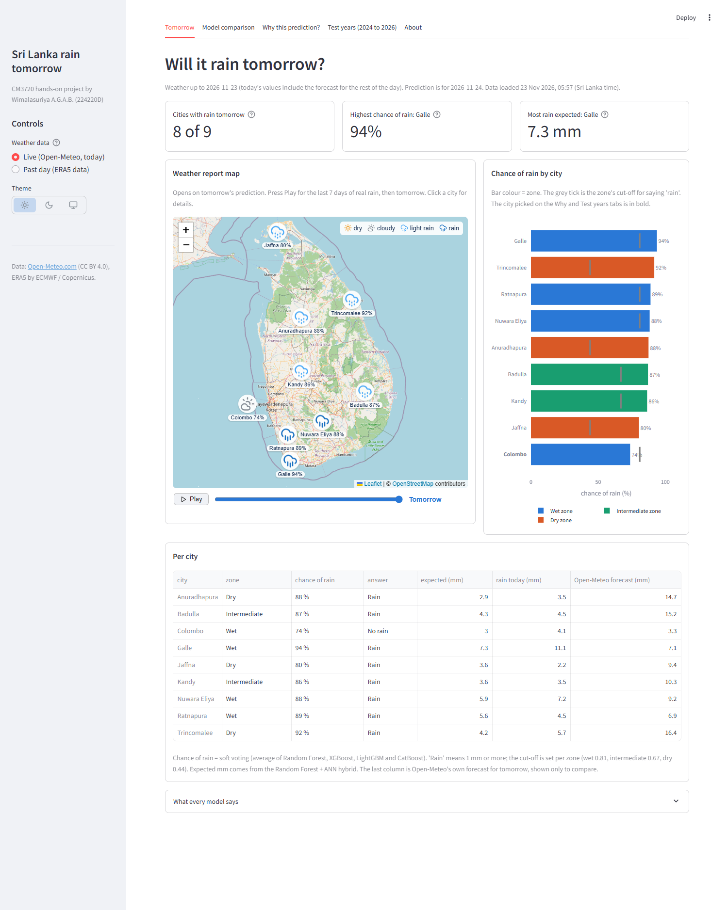

# Sri Lanka rain tomorrow: an ensemble learning dashboard

Will it rain tomorrow in a Sri Lankan city? This project predicts next-day rain for 9 cities across the
wet, intermediate and dry zones, compares bagging, boosting, stacking, voting and hybrid models, explains the
predictions with SHAP, and shows everything in a Streamlit dashboard with live weather.

**Live app: [sl-rain-tomorrow.streamlit.app](https://sl-rain-tomorrow.streamlit.app)**

**Notebook in Google Colab: [open the notebook](https://colab.research.google.com/github/AdithaBuwaneka/224220D-SL-Rain-Ensemble-Dashboard/blob/main/224220D_Wimalasuriya_AGAB_SL_Rain_Ensemble.ipynb)**

CM3720 Machine Learning & Pattern Recognition hands-on project by Wimalasuriya A.G.A.B. (224220D)

## System architecture


## Dashboard



- **Tomorrow:** chance of rain for every city on an OpenStreetMap weather map (press Play to see the last 7 days),
  chance by city with each zone's cut-off, and the expected amount of rain
- **Model comparison:** all models on the test years with 95% intervals, by zone and by monsoon season, and
  whether the chance of rain can be trusted
- **Why this prediction?:** SHAP explanation for any city, and the features that matter most in each zone
- **Test years:** confusion matrix and day-by-day results for each city in 2024 to 2026
- Sidebar: live or past-day weather and the theme (it can be hidden to widen the charts); the city is picked at the
  top of the SHAP and test-year tabs, and both tabs always show the same city
- Theme buttons in the sidebar: light (the default), dark, or the computer's own setting, with no page reload

## Data

| | |
|---|---|
| Source | [Open-Meteo](https://open-meteo.com/) Historical Weather API, ERA5 reanalysis (ECMWF / Copernicus) |
| Cities | Colombo, Galle, Ratnapura, Kandy, Nuwara Eliya, Badulla, Anuradhapura, Trincomalee, Jaffna |
| Period | daily, 1 Jan 2010 to 15 Nov 2026 (55,467 rows, no missing values) |
| Zones | worked out from each city's yearly rain in the training years: wet > 2,500 mm, intermediate 1,750 to 2,500 mm, dry < 1,750 mm |
| Label | rain of 1 mm or more tomorrow (the ETCCDI "wet day"); 5 mm or more is also compared |

Weather data by Open-Meteo.com, licensed under CC BY 4.0.

## Method

- **Features (45):** today's weather, rain over the last few days, changes since yesterday, season (four
  monsoon periods), zone and city. Only data up to today is used for each prediction.
- **Split by time:** train 2010 to 2021, validation 2022 to 2023, test 2024 to Nov 2026. No shuffling, so no
  information from the future leaks into training.
- **Models:** decision tree, bagging, Random Forest, AdaBoost, XGBoost, LightGBM, CatBoost, soft voting, stacking,
  ARIMA + Random Forest hybrid, and Random Forest + ANN for the amount of rain.
- **Baselines:** climatology (the usual chance for that city) and persistence (tomorrow = today).
- **Tuning:** a grid search for each model, scored on the validation years (not k-fold, which would mix days
  from different years). The values tried and the reason for each are in the notebook (5.2), with checks for
  overfitting and ccp_alpha pruning of the decision tree.
- **Evaluation:** ROC-AUC, balanced accuracy, F1, precision and recall (classification report), confusion
  matrices, calibration, bootstrap intervals, and results by zone, season and year.

## Results (test years 2024 to Nov 2026)

| Model | ROC-AUC | Balanced accuracy | F1 |
|---|---|---|---|
| Baseline: climatology | 0.713 | 0.641 | 0.745 |
| Baseline: persistence | 0.782 | 0.782 | 0.834 |
| Decision tree | 0.875 | 0.779 | 0.839 |
| Random Forest (bagging) | 0.886 | 0.792 | 0.852 |
| XGBoost (boosting) | 0.888 | 0.796 | 0.851 |
| **CatBoost (boosting)** | **0.890** | 0.796 | 0.853 |
| Stacking | 0.889 | 0.789 | **0.854** |
| Soft voting (used in the dashboard) | 0.889 | 0.797 | **0.854** |
| Hybrid: ARIMA + RF | 0.888 | **0.800** | **0.854** |

Rain amount: Random Forest + ANN gave the lowest error (MAE 4.34 mm, R² 0.33), compared with 5.33 mm for persistence.

Main findings:

- Every ensemble beats the simple baselines and a single tree, but the differences between the ensembles are small.
  A bootstrap of the test days (1,000 resamples) shows that CatBoost, XGBoost and stacking cannot be told apart
  from soft voting.
- The chances given by soft voting match how often it really rained (lowest Brier score, 0.130, tied with
  CatBoost), so the dashboard shows them as they are. Stacking was over-confident at high chances.
- The wet zone is the easiest to predict and the dry zone in the first inter-monsoon is the hardest. With the zone
  cut-offs, the intermediate zone missed the most rain days (31%).
- Choosing the cut-off for each zone raised the wet zone's balanced accuracy from 0.72 to 0.80.

The full discussion is in the notebook.

## Project structure

```
224220D_Wimalasuriya_AGAB_SL_Rain_Ensemble.ipynb   notebook: data, features, training, evaluation, SHAP, discussion
app.py                                              Streamlit dashboard
src/
  download_data.py                                  downloads the ERA5 data from Open-Meteo
  features.py                                       features (same code for the notebook and the dashboard)
  predict.py                                        loads the saved models and makes predictions
models/                                             saved models (.joblib) and model_info.json
data/raw/                                           downloaded weather data
data/processed/                                     test-year predictions used by the dashboard
images/                                             charts, diagram and dashboard screenshot
requirements.txt
```

## Run it

Tested with **Python 3.13** on Windows. Keep the package versions in `requirements.txt`: the saved models only load
with the same scikit-learn, XGBoost, LightGBM and CatBoost versions they were saved with.

**1. Get the code and install the packages**

```bash
git clone https://github.com/AdithaBuwaneka/224220D-SL-Rain-Ensemble-Dashboard.git
cd 224220D-SL-Rain-Ensemble-Dashboard
python -m venv .venv
.venv\Scripts\activate             # Windows
# source .venv/bin/activate        # macOS / Linux
pip install -r requirements.txt
```

**2. Run the dashboard**

```bash
streamlit run app.py
```

It opens at http://localhost:8501. Live mode gets today's weather from Open-Meteo (internet needed, no API key).
Without internet the dashboard uses the last day in the saved ERA5 data instead.

**3. Run the notebook (optional, retrains everything)**

```bash
pip install notebook
jupyter notebook 224220D_Wimalasuriya_AGAB_SL_Rain_Ensemble.ipynb
```

Then choose Kernel, Restart & Run All (or Run All in VS Code with the Jupyter extension). It takes about 15 minutes
on a laptop CPU. It reads `data/raw/` and writes the models to `models/`, the charts to `images/` and the test-year
predictions to `data/processed/`, which the dashboard then uses.

**In Google Colab:** open the [Colab link](https://colab.research.google.com/github/AdithaBuwaneka/224220D-SL-Rain-Ensemble-Dashboard/blob/main/224220D_Wimalasuriya_AGAB_SL_Rain_Ensemble.ipynb)
and choose Runtime, Run all. The first code cell downloads this repo (for the data and the `src` folder) and
installs CatBoost, so nothing has to be uploaded by hand. On the free Colab CPU it takes about 30 minutes. Colab
uses its own library versions (for example scikit-learn 1.6.1), so a few numbers can differ slightly in the third
decimal place (the ROC-AUC values and the ranking of the models stay the same).

**Download the data again (optional):** `python src/download_data.py` gets the same ERA5 data from the Open-Meteo
Historical Weather API and saves it to `data/raw/`.

## AI-use declaration

- **AI-assisted (Claude):** writing all of the code and its comments (the notebook, the dashboard and the
  scripts that draw the charts and images), and the wording of my written sections (the points and
  decisions in them are my own).
- **My own work:** the project idea and the research questions, the choice of data, cities and rain thresholds,
  the planning, the modelling decisions, the plan and Excalidraw-style look of the architecture diagram, and the
  interpretation of the results and the conclusions.
- **How I used it:** I decided what to build and checked the outputs at each step; the AI wrote the code for it.
  I reviewed the code and the results, and I take responsibility for the submitted work.
