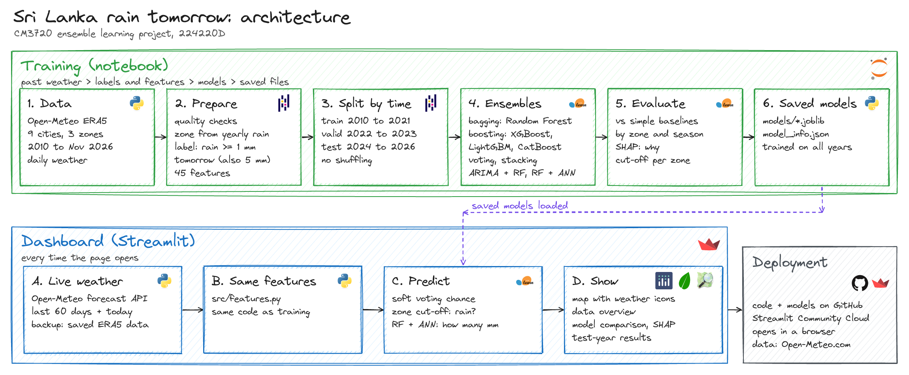

# Sri Lanka rain tomorrow: an ensemble learning dashboard

Will it rain tomorrow in a Sri Lankan city? This project predicts next-day rain for 9 cities across the
wet, intermediate and dry zones, compares bagging, boosting, stacking, voting and hybrid models, explains the
predictions with SHAP, and shows everything in a Streamlit dashboard with live weather.

CM3720 Machine Learning & Pattern Recognition hands-on project by Wimalasuriya A.G.A.B. (224220D)



## Dashboard


- **Tomorrow:** chance of rain for every city on an OpenStreetMap weather map (press Play to see the last 7 days),
  chance by city with each zone's cut-off, and the expected amount of rain
- **Model comparison:** all models on the test years, by zone and by monsoon season, and whether the chance of
  rain can be trusted
- **Why this prediction?:** SHAP explanation for any city
- **Test years:** how the model did day by day in 2024 to 2026
- Opens in light mode; dark mode and the computer's own setting can be chosen with the buttons in the sidebar

Live app: *(link added after deployment)*

## Data

| | |
|---|---|
| Source | [Open-Meteo](https://open-meteo.com/) Historical Weather API, ERA5 reanalysis (ECMWF / Copernicus) |
| Cities | Colombo, Galle, Ratnapura, Kandy, Nuwara Eliya, Badulla, Anuradhapura, Trincomalee, Jaffna |
| Period | daily, 1 Jan 2010 to 15 Nov 2026 (55,467 rows, no missing values) |
| Zones | worked out from each city's yearly rain in the training years: wet > 2,500 mm, intermediate 1,750 to 2,500 mm, dry < 1,750 mm |
| Label | rain of 1 mm or more tomorrow (the ETCCDI "wet day"); 5 mm or more is also compared |

Weather data by Open-Meteo.com, licensed under CC BY 4.0.

## Method

- **Features (45):** today's weather, rain over the last few days, changes since yesterday, season (four
  monsoon periods), zone and city. Only data up to today is used for each prediction.
- **Split by time:** train 2010 to 2021, validation 2022 to 2023, test 2024 to Nov 2026. No shuffling, so no
  information from the future leaks into training.
- **Models:** decision tree, bagging, Random Forest, AdaBoost, XGBoost, LightGBM, CatBoost, soft voting, stacking,
  ARIMA + Random Forest hybrid, and Random Forest + ANN for the amount of rain.
- **Baselines:** climatology (the usual chance for that city) and persistence (tomorrow = today).

## Results (test years 2024 to Nov 2026)

| Model | ROC-AUC | Balanced accuracy | F1 |
|---|---|---|---|
| Baseline: climatology | 0.713 | 0.641 | 0.745 |
| Baseline: persistence | 0.782 | 0.782 | 0.834 |
| Decision tree | 0.868 | 0.785 | 0.840 |
| Random Forest (bagging) | 0.886 | 0.792 | 0.851 |
| XGBoost (boosting) | 0.888 | 0.794 | 0.851 |
| CatBoost (boosting) | 0.889 | 0.794 | 0.851 |
| Stacking | 0.889 | 0.790 | 0.855 |
| **Soft voting** | **0.889** | 0.797 | 0.854 |
| Hybrid: ARIMA + RF | 0.888 | **0.802** | 0.854 |

Rain amount: Random Forest + ANN gave the lowest error (MAE 4.34 mm, R² 0.33), compared with 5.33 mm for persistence.

Main findings:

- Every ensemble beats the simple baselines and a single tree, but the differences between the ensembles are small.
  A bootstrap of the test days (1,000 resamples) shows that CatBoost, XGBoost, stacking and the ARIMA + RF hybrid
  cannot be told apart from soft voting.
- The chances given by soft voting match how often it really rained (lowest Brier score, 0.130), so the dashboard
  shows them as they are. Stacking was over-confident at high chances.
- The wet zone is the easiest to predict and the dry zone in the first inter-monsoon is the hardest. With the zone
  cut-offs, the intermediate zone missed the most rain days (31%).
- Choosing the cut-off for each zone raised the wet zone's balanced accuracy from 0.72 to 0.80.

The full discussion is in the notebook.

## Project structure

```
224220D_Wimalasuriya_AGAB_SL_Rain_Ensemble.ipynb   notebook: data, features, training, evaluation, SHAP, discussion
app.py                                              Streamlit dashboard
src/
  download_data.py                                  downloads the ERA5 data from Open-Meteo
  features.py                                       features (same code for the notebook and the dashboard)
  predict.py                                        loads the saved models and makes predictions
models/                                             saved models (.joblib) and model_info.json
data/raw/                                           downloaded weather data
data/processed/                                     test-year predictions used by the dashboard
images/                                             charts, diagram and dashboard screenshot
requirements.txt
```

## Run it

```bash
pip install -r requirements.txt
streamlit run app.py
```

To download the data again: `python src/download_data.py`. To retrain, run the notebook from top to bottom.

## AI-use declaration

- **AI-assisted (Claude):** writing all of the code and its comments (the notebook, the dashboard and the
  scripts that draw the charts and images), and the wording of my written sections (the points and
  decisions in them are my own).
- **My own work:** the project idea and the research questions, the choice of data, cities and rain thresholds,
  the planning, the modelling decisions, the plan and Excalidraw-style look of the architecture diagram, and the
  interpretation of the results and the conclusions.
- **How I used it:** I decided what to build and checked the outputs at each step; the AI wrote the code for it.
  I reviewed the code and the results, and I take responsibility for the submitted work.
